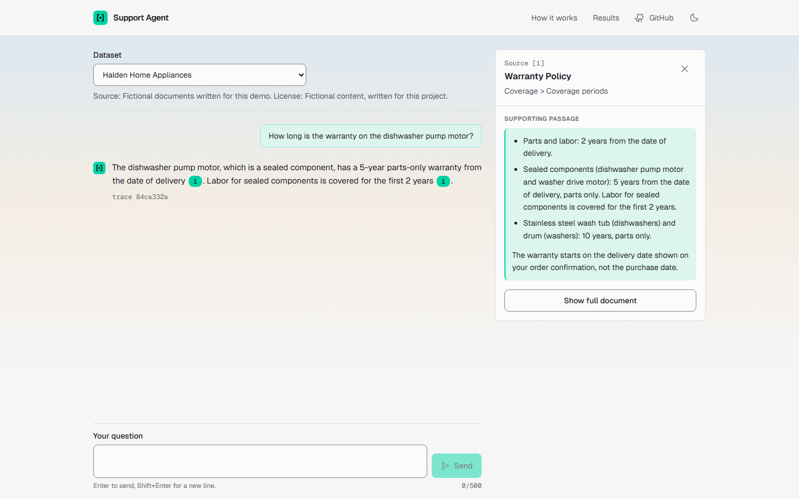
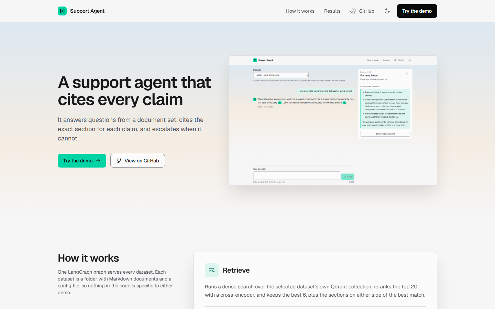
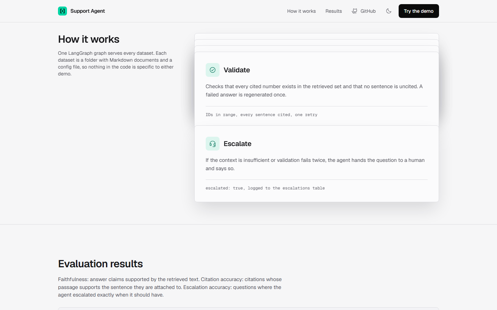
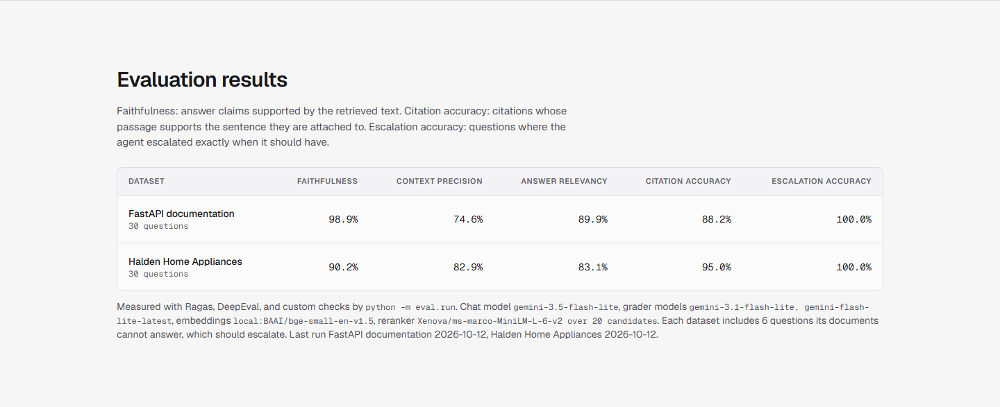
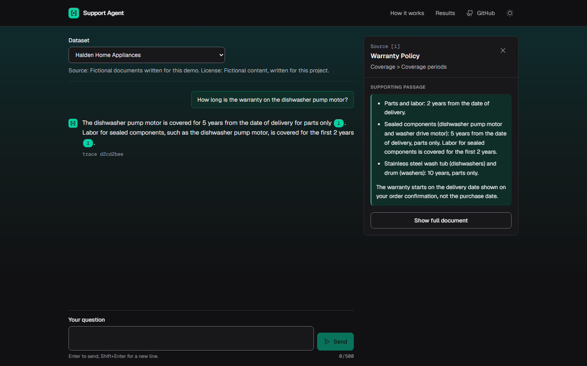
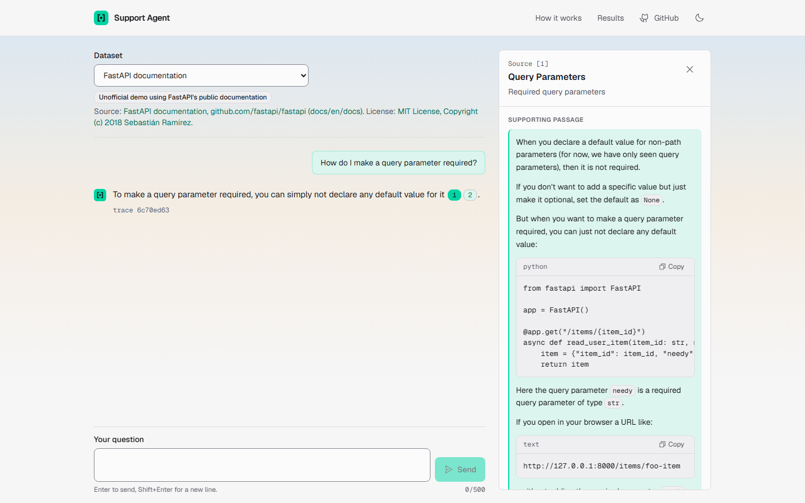
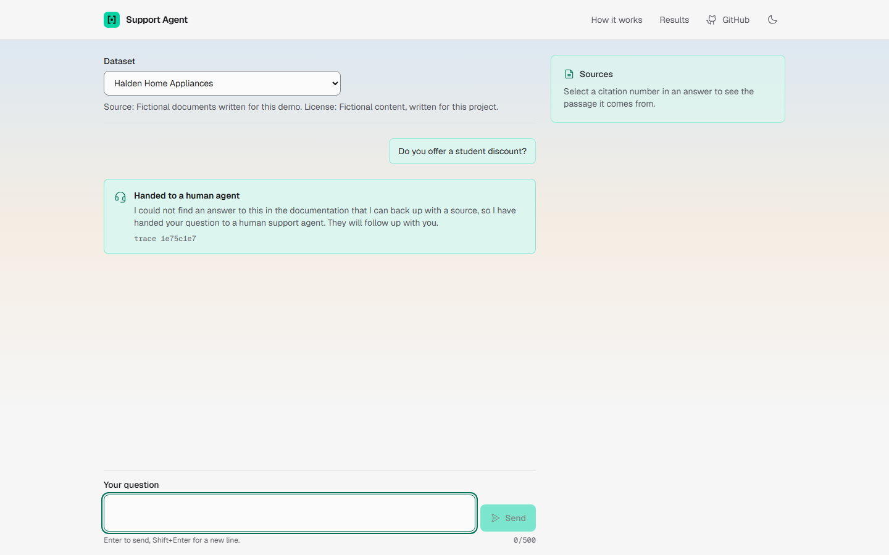
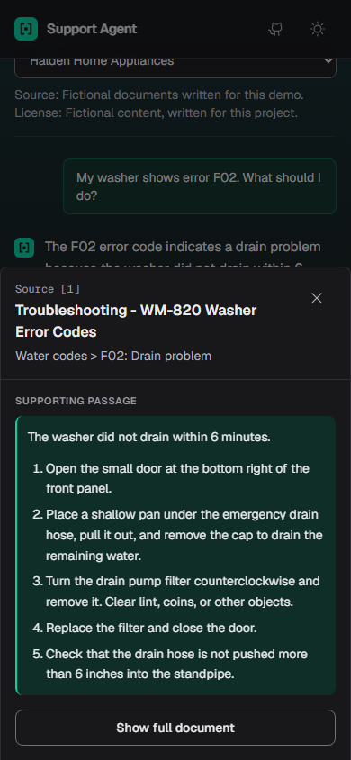
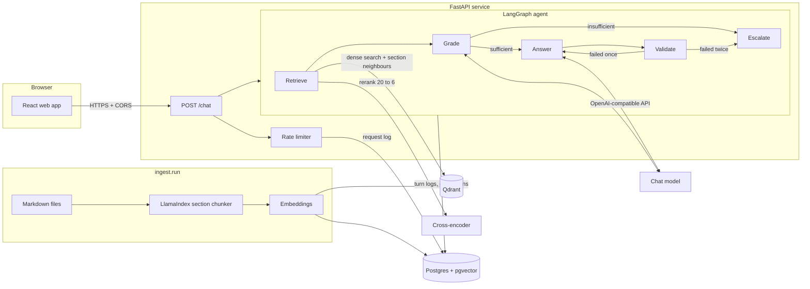

# Support Agent

A retrieval-augmented customer support agent. It answers questions from a document set, cites the exact source section for every claim, and hands the question to a human when the documents do not support an answer.

The system is dataset-agnostic and ships with two datasets:

- **Halden Home Appliances** (default): 15 fictional support documents covering warranty, returns, shipping, installation guides, error codes, billing, and account help.
- **FastAPI documentation**: the English docs from the FastAPI repository, pinned to a tagged release. This is an unofficial demo using FastAPI's public documentation. It is not FastAPI's official support and is not affiliated with the FastAPI project.



## Screenshots

All screenshots are captured from the running app with real model answers (`cd web && node scripts/readme-shots.mjs`).

**Landing page**



<table>
<tr>
<td width="50%"><b>How it works</b>: the five graph steps as cards that stack while scrolling<br><br></td>
<td width="50%"><b>Evaluation results</b>: read from <code>eval/results/*/latest.json</code> at build time<br><br></td>
</tr>
</table>

**Cited answer (dark theme)**: each citation number opens the exact passage it came from



**FastAPI dataset**: the source panel shows the documentation passage, including its code, and links to the live page on fastapi.tiangolo.com



<table>
<tr>
<td width="62%"><b>Handoff</b>: a question the documents cannot answer is passed to a human instead of guessed<br><br></td>
<td width="38%"><b>Phone</b>: the source panel opens as a bottom sheet<br><br></td>
</tr>
</table>

## Architecture



The graph is the same for every dataset:

1. **Retrieve**: embed the question and run a dense search in the dataset's own Qdrant collection, `docs_<name>`, for 20 candidates. A local cross-encoder reranks them and the best k (6 by default) are kept. Up to two sections on either side of the best match, from the same document, are added, because a page's how-to and its explanation often sit in neighbouring sections. Reranking and expansion can be turned off in `.env`.
2. **Grade**: a model call decides whether the retrieved sections contain the answer. If not, go to Escalate.
3. **Answer**: generate from numbered context blocks only, using the dataset's persona, citing inline as `[1]`, `[2]`.
4. **Validate**: every cited number must exist in the retrieved set and every sentence and list item must carry a citation. A failed answer is regenerated once, then escalated.
5. **Escalate**: return a handoff message and set `escalated: true`.

Every turn is logged to Postgres with the dataset, question, retrieved chunk IDs, answer, citations, escalation flag, latency, and trace ID.

## Stack

- Backend: Python 3.11+ (tested on 3.12 in Docker and 3.13 locally), FastAPI, LangGraph, LlamaIndex
- Retrieval: Qdrant for dense search; PostgreSQL with pgvector for documents, chunks, conversation logs, escalations, and the rate-limit log
- Models: any OpenAI-compatible chat endpoint (Gemini by default, OpenAI supported); local fastembed embeddings by default, OpenAI embeddings supported. See [DECISIONS.md](DECISIONS.md) for why.
- Evaluation: Ragas, DeepEval, and custom citation and escalation checks
- Frontend: React, Vite, TypeScript, Tailwind v4, Motion, Phosphor icons
- Infra: Docker Compose

## Setup

Requirements: Docker with Compose, and an API key for a chat model. A free Gemini key from [Google AI Studio](https://aistudio.google.com) works.

```bash
cp .env.example .env
```

Open `.env` and set `LLM_API_KEY`. To use OpenAI instead, leave `LLM_BASE_URL` empty and set `LLM_MODEL` to an OpenAI model. Set `ADMIN_TOKEN` and `IP_HASH_SALT` to long random strings.

```bash
docker compose up -d --build
```

This starts Qdrant, Postgres, the API on http://localhost:8000, and the web app on http://localhost:5173. The datasets still need to be ingested (next section).

### Local development without Docker for the app

```bash
docker compose up -d qdrant postgres
python -m venv .venv
.venv/Scripts/activate   # Windows; use source .venv/bin/activate on macOS and Linux
pip install -r requirements-dev.txt
uvicorn app.main:app --reload
```

```bash
cd web
npm install
npm run dev
```

## Datasets

Each dataset is a folder in `data/<name>/` with:

- `dataset.yaml`: display name, description, source, license, notice label, Markdown flavor, source URL style, chunking settings, and assistant persona
- `docs/` (or the path in `docs_dir`): the Markdown documents
- `questions.jsonl`: evaluation questions with expected answers and source sections
- `examples.json`: three example questions shown in the chat empty state

Nothing in the code refers to a specific dataset. Adding a folder with a `dataset.yaml` adds a dataset.

### Halden

The documents are committed. Ingest them:

```bash
python -m ingest.run --dataset halden          # prints chunk count and estimated embedding cost
python -m ingest.run --dataset halden --yes    # embeds and writes
```

With Docker only: `docker compose exec api python -m ingest.run --dataset halden --yes`.

### FastAPI

The raw docs are not committed. The fetch script downloads the pinned release from GitHub and records the tag, commit SHA, and fetch date in [`data/fastapi/SOURCE.md`](data/fastapi/SOURCE.md):

```bash
python -m ingest.fetch_fastapi
python -m ingest.run --dataset fastapi --yes
```

Or both datasets at once: `python -m ingest.run --dataset all --yes`.

Ingestion is idempotent. Unchanged documents are skipped, removed documents are deleted, and the collection is rebuilt if the embedding size changes. `--force` re-embeds everything.

## Evaluation

The API must be running and `ADMIN_TOKEN` set in `.env` (the eval runner uses it to skip the public rate limit).

```bash
python -m eval.run --dataset halden
python -m eval.run --dataset all
```

For each question the runner calls `POST /chat`, reads the retrieved chunks for that turn from the conversation log, and reports:

- **Ragas**: faithfulness, context precision, answer relevancy
- **DeepEval**: faithfulness regression suite. The run exits with status 1 if mean faithfulness is below `EVAL_FAITHFULNESS_THRESHOLD` (default 0.8). `python -m eval.regression --dataset <name>` re-runs only this check.
- **Citation accuracy** (custom): the share of citations whose passage supports the sentence it is attached to
- **Escalation accuracy**: whether the agent escalated exactly when it should have. Each dataset has 6 questions its documents cannot answer.
- **Retrieval hit rate**: whether the expected section was among the top k retrieved chunks

Results go to `eval/results/<name>/latest.json`, `latest.md`, and a timestamped JSON copy. Agent responses and grader replies are cached, so a run interrupted by a quota limit resumes where it stopped. Update the table below with `python -m eval.readme_table`.

### Results

<!-- results:start -->
| Dataset | Faithfulness (Ragas) | Context precision (Ragas) | Answer relevancy (Ragas) | Faithfulness (DeepEval) | Citation accuracy | Escalation accuracy | Retrieval hit rate |
| --- | --- | --- | --- | --- | --- | --- | --- |
| FastAPI documentation | 0.990 | 0.746 | 0.899 | 1.000 | 0.882 | 1.000 | 1.000 |
| Halden Home Appliances | 0.903 | 0.830 | 0.831 | 0.972 | 0.950 | 1.000 | 1.000 |

- FastAPI documentation: 30 questions, run 2026-10-12. Chat model `gemini-3.5-flash-lite`, grader `gemini-3.1-flash-lite`, `gemini-flash-lite-latest`, embeddings `local:BAAI/bge-small-en-v1.5`, reranker `Xenova/ms-marco-MiniLM-L-6-v2 over 20 candidates`. Answered 24, escalated 6. Citations supported: 45 of 51. Escalations: 0 missed, 0 false. Median latency 5200 ms. Full report: [`eval/results/fastapi/latest.md`](eval/results/fastapi/latest.md).
- Halden Home Appliances: 30 questions, run 2026-10-12. Chat model `gemini-3.5-flash-lite`, grader `gemini-3.1-flash-lite`, embeddings `local:BAAI/bge-small-en-v1.5`, reranker `Xenova/ms-marco-MiniLM-L-6-v2 over 20 candidates`. Answered 24, escalated 6. Citations supported: 38 of 40. Escalations: 0 missed, 0 false. Median latency 2741 ms. Full report: [`eval/results/halden/latest.md`](eval/results/halden/latest.md).
<!-- results:end -->

These results use the current retrieval pipeline: dense search, cross-encoder reranking, and neighbouring sections. Reranking raised the retrieval hit rate to 1.000 on both datasets (optimistic: the retrieval settings were chosen by testing on these same questions), at the cost of latency: the median answer time rose to about 2.7 s (Halden) and 5.2 s (FastAPI) on CPU. The grader is a small free model and is noisy: for example, Halden h09 ("Care Plus covers damage from power surges", nearly verbatim from the source) scored 0.0 on Ragas faithfulness and 1.0 on DeepEval. Per-question scores are in each `latest.md`.

The graders are small free-tier models from the same family as the agent, so treat these scores as indicative. The FastAPI questions are drafts pending human review (see [DECISIONS.md](DECISIONS.md)).

## Tests

```bash
pytest                       # unit tests: chunking, citations, graph and escalation, isolation, rate limiting, API, model client
pytest -m integration        # ingests Halden into the Docker Qdrant and Postgres and calls /chat
cd web && npx playwright test  # frontend: send, switch dataset, citation panel, escalation, error, rate limit, mobile sheet
```

The integration test needs `docker compose up -d qdrant postgres`. It uses a stand-in chat model so it is free and repeatable. `RUN_LLM_TESTS=1` uses the real one.

Screenshots for the landing page and this README are captured from the running app with `cd web && npm run screenshots`.

## Configuration

Every setting is an environment variable, listed with defaults in [`.env.example`](.env.example): chat model, fallbacks, embedding provider, top k, regeneration count, Qdrant and Postgres URLs, default dataset, rate limit per hour, daily cap, maximum question length, IP hash salt, web origin for CORS, admin token, and evaluation settings. Never commit `.env`.

## Project structure

```
app/        FastAPI app, LangGraph graph, citation validation, rate limiting, Postgres and Qdrant access, model clients
ingest/     Markdown loading and chunking, MkDocs cleanup, FastAPI fetch script, ingestion command
eval/       evaluation runner, custom metrics, DeepEval regression suite, results
tests/      unit and integration tests
data/       one folder per dataset
web/        React app, Playwright tests, screenshot and favicon scripts
```

## Attribution and license

The FastAPI dataset is built from the [FastAPI documentation](https://fastapi.tiangolo.com) in [github.com/fastapi/fastapi](https://github.com/fastapi/fastapi), MIT License, Copyright (c) 2018 Sebastián Ramírez. The license text is in [`data/fastapi/LICENSE`](data/fastapi/LICENSE). This project is an unofficial demo and is not affiliated with or endorsed by the FastAPI project. The FastAPI logo is not used.

Halden Home Appliances is fictional. Its documents were written for this project.

Geist and Geist Mono are used under the SIL Open Font License ([`web/src/assets/fonts/OFL-LICENSE.txt`](web/src/assets/fonts/OFL-LICENSE.txt)).

## Pre-launch checklist

The project is **not deployable** until every item is checked.

- [ ] Custom domain connected: DNS configured, HTTPS working, apex and www both resolve or redirect
- [x] Favicon: SVG plus PNG fallbacks and an apple-touch-icon (`web/public`)
- [x] Privacy policy page at `/privacy`, linked from every page footer
- [x] Terms page at `/terms`, linked from every page footer
- [x] Contact email and data retention periods on the privacy and terms pages
- [x] Governing law on the terms page (India, courts in Haryana)
- [x] `VITE_GITHUB_URL` set to the repository URL
- [ ] Production `.env`: new `LLM_API_KEY` (rotate any key that was shared in chat or logs), long random `ADMIN_TOKEN` and `IP_HASH_SALT`, `WEB_ORIGIN` and `VITE_API_URL` set to the production URLs, `TRUST_PROXY_HEADERS=true` only behind a proxy that sets `X-Forwarded-For`
- [ ] `DAILY_REQUEST_CAP` below the model provider's daily quota, and a spending limit set with the provider if billing is on
- [ ] FastAPI evaluation questions reviewed by a person before the results are published
